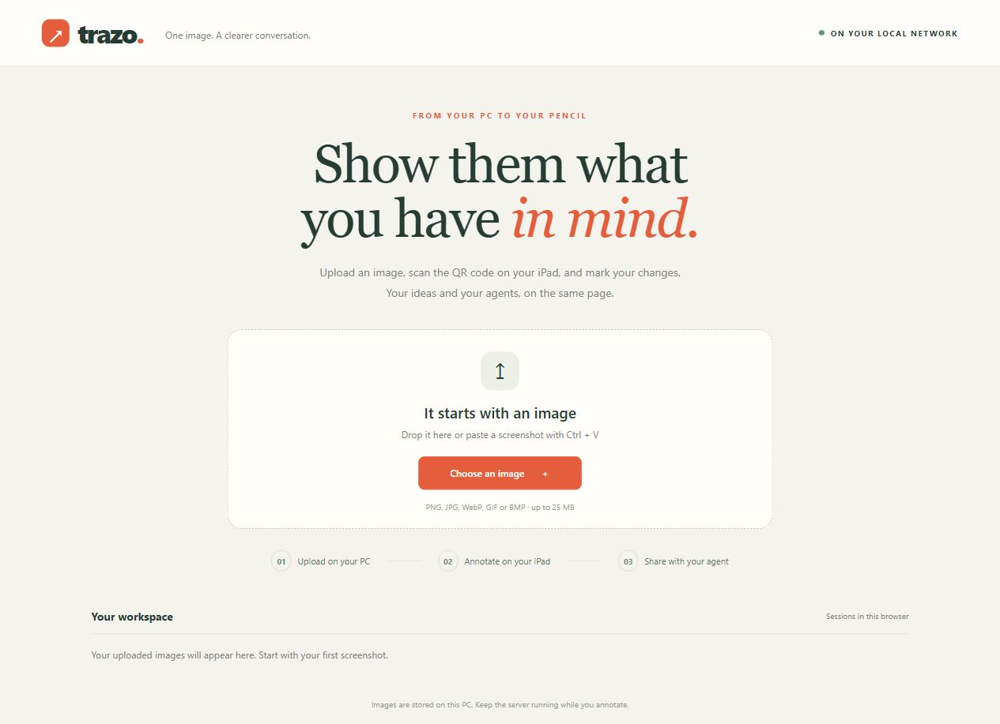
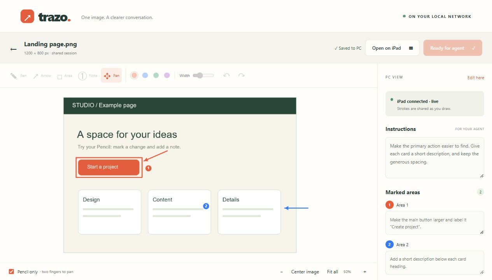
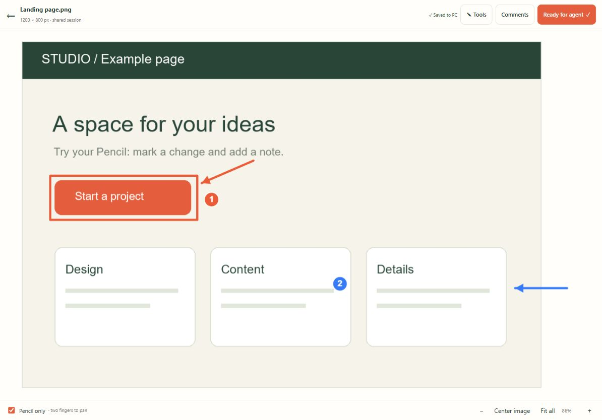

# Trazo

**Show your AI agents what you want to change.**

Upload an image on your computer, scan a QR code with your iPad, and annotate it with Apple Pencil. Your computer sees the strokes as you draw. Export the complete annotated canvas and written instructions for your agent.

Trazo runs on your computer and works over your local network. No native iPad app, cloud account, or external AI service is required.



## How it works

1. **Upload on your computer.** Drop an image, select a file, or paste a screenshot.
2. **Scan the QR code.** Open the shared session in Safari on your iPad. Both devices must be on the same local network.
3. **Draw and explain.** Use the pen, arrows, rectangles, and numbered notes. You can write outside the original image, too.
4. **Watch on your computer.** Strokes arrive while you draw. The QR dialog closes when the iPad connects.
5. **Share with your agent.** Preview the complete image, download the package, and attach it to your agent conversation.

### Desktop workspace

See your image, numbered comments, and export controls together. The desktop opens in view mode; choose **Edit here** to annotate with a mouse.



### iPad workspace

The pen is active immediately, with **Tools** and **Comments** collapsed. In **Pencil only** mode, use two fingers to pan and zoom. Placing a numbered note returns to the pen without opening the keyboard or scrolling to a text field.



These are real browser screenshots using synthetic example content. The iPad layout is shown at a tablet viewport size; it is not a photograph of a physical device.

## Quick start

You need **Python 3.11 or newer**, a computer, and an iPad with Safari on the same network. Installing dependencies requires an internet connection; annotating does not.

```sh
git clone https://github.com/josemlopez/trazo.git
cd trazo
```

### Windows

Double-click **Start.cmd**, or run:

```powershell
powershell -NoProfile -ExecutionPolicy Bypass -File .\Start.ps1
```

The launcher creates `.venv`, installs the pinned dependencies, starts the server in the background, and opens [localhost:8795](http://localhost:8795). Logs are written to `server.log` and `server-error.log`.

Manual setup:

```powershell
python -m venv .venv
.\.venv\Scripts\python.exe -m pip install -r requirements-lock.txt
.\.venv\Scripts\python.exe server.py
```

The original `Iniciar.cmd` and `Iniciar.ps1` entry points remain as compatibility wrappers.

### macOS and Linux

The Python server can also be started manually:

```sh
python3 -m venv .venv
.venv/bin/python -m pip install -r requirements-lock.txt
.venv/bin/python server.py
```

Open [localhost:8795](http://localhost:8795) on the host computer. The supplied background launcher is Windows-specific; keep the terminal open for manual startup and press Ctrl+C to stop it. The current release was tested on Windows; macOS and Linux setup has not been verified on physical machines.

## Features

- Live stroke sharing over WebSocket, with periodic refresh as a fallback.
- Autosave after a short pause, plus a browser draft for interrupted connections.
- Pen, arrows, rectangles, numbered comments, colors, stroke width, undo, and redo.
- A writing surface that extends beyond the image. **Fit all** includes exterior annotations; **Center image** returns to the source image.
- **Agent preview** shows the complete exported image, including notes in the margins.
- Version checks to prevent one editor from silently overwriting another.
- Local storage, with the uploaded original preserved byte for byte.

Keep the server running and Safari open while drawing. Prefer one active editor at a time. If a version conflict occurs, download your local draft before loading the newer PC version.

Keyboard shortcuts: **P** pen, **A** arrow, **R** rectangle, **N** numbered note, **M** pan, **Ctrl/Cmd+Z** undo, and **Ctrl/Cmd+Shift+Z** redo.

## What your agent receives

**Ready for agent** saves the session and generates a ZIP on the computer. **Download package** downloads a fresh snapshot containing:

| File | Contents |
| --- | --- |
| `original.*` | Your uploaded file, unchanged |
| `base.png` | The oriented image used as the coordinate reference |
| `annotated.png` | The image with every saved mark, including writing outside its edges |
| `instructions.md` | General instructions, numbered comments, and coordinate information |
| `annotations.json` | Editable strokes, areas, comments, and session metadata |

**Copy agent prompt** copies a message that tells the agent to read the image and its margins. Trazo does not send messages to agents automatically. Your own notes remain in the language you wrote them.

## Local data and privacy

Session state lives in `data/sessions.sqlite3`; uploaded files and generated exports live in `data/<session-id>/`. Browser drafts and recent-session links are stored in that browser.

This repository contains only source code, launchers, documentation, dependencies, and synthetic screenshots. User images, sessions, annotations, databases, logs, exports, and local environments are excluded. `.gitignore` uses an explicit file allowlist, so new files must be reviewed and added deliberately.

Session links contain a random 128-bit identifier. Anyone with a link and access to the server can view and edit that session. This version is intended for a trusted local network and has no account login or HTTPS setup; do not expose it directly to the internet.

## Connecting your iPad

The server detects its local network address at startup and puts it in the QR code. If the host IP changes, restart the server. For a specific interface, set `ANNOTATOR_BASE_URL` to `http://<HOST-IP>:8795` before starting it.

If Safari cannot connect, check:

- Both devices can communicate on the same network; guest Wi-Fi may isolate devices.
- The host firewall allows incoming TCP connections on port **8795** from the local network.
- The server is running. Opening `localhost` on the iPad refers to the iPad itself; use the QR link instead.

The manual server also accepts `ANNOTATOR_PORT`. The Windows launcher uses port 8795. Pencil gestures and palm behavior should be checked on your own iPad.

## Image limits

Uploads support PNG, JPEG, WebP, GIF, and BMP, up to **25 MB** and **45 million pixels**. GIF uses its first frame. The working image is oriented and resized to at most **4096 px per side**.

Annotation coordinates are relative to the working image and can extend to **±16384 px per axis**. Exports include every annotation, scaling down when necessary to stay within **8192 px per side** and **24 megapixels**. The original is never resized or overwritten.

## Development and verification

Backend: FastAPI, Uvicorn, SQLite, Pillow, and qrcode. Frontend: HTML, CSS, and JavaScript, with no build step or third-party runtime assets.

With the server running on port 8795:

```powershell
.\.venv\Scripts\python.exe tools\verify.py
```

On macOS or Linux, use `.venv/bin/python tools/verify.py`.

The script generates synthetic content and checks upload, autosave, revision conflicts, original-file preservation, QR generation, complete exports, coordinate validation, live strokes before saving, and tablet presence. It creates a test session and an example image locally.

After updating Trazo, wait for **Saved to PC**, then reload both browsers. Existing sessions and annotation coordinates remain compatible. New exports use English filenames; previously generated files remain on disk.
